<div align="center">

# shelf-to-screen — A Validated Panel of Texas Public Library Statistics, 2018–2023

**shelf-to-screen is a panel-data kit for library researchers and analysts. It takes six yearly Texas public library statistics files through these steps to a report on the shift from print to digital:**

`ingest` → `link libraries` → `build the panel` → `total and check` → `backtest forecasts` → `fixed-effects regression` → `report`.


**[Summary](#1-summary)** ·
**[Workflow](#4-the-end-to-end-workflow)** ·
**[Run it](#10-how-to-run-shelf-to-screen)** ·
**[Configuration](#104-environment-variables)** ·
**[Known problems](#13-known-problems)** ·
**[Glossary](#15-glossary)**

</div>

> [!NOTE]
> This README uses ASD-STE100 Simplified Technical English. The writing rules and the project
> vocabulary are in [`docs/ste-style-guide.md`](docs/ste-style-guide.md). Each term in the
> [Glossary](#15-glossary) has only one meaning.

---

shelf-to-screen reads the yearly statistics files of Texas public libraries and makes one validated row for each library and year.
It computes each state total from the panel. It compares all libraries with the balanced panel to separate real change from changes in who reports.
Forecasts get a rolling-origin backtest against simple baselines. The regression removes library and year effects and clusters the errors by library.

This README is the **one location that explains all of shelf-to-screen**. It gives these topics:

- the general design
- each component and its procedure, step by step
- the decision rules
- the data map
- the runbook
- the validation results and the known problems

| If you are… | Read |
|---|---|
| A manager or reviewer | [1](#1-summary), [3](#3-design-rules), [4](#4-the-end-to-end-workflow), [12](#12-validation-results), [14](#14-key-points) |
| A developer who joins the project | All sections, in sequence. Keep [10](#10-how-to-run-shelf-to-screen) and [13](#13-known-problems) open while you work |
| An operator who runs shelf-to-screen | [10](#10-how-to-run-shelf-to-screen), then the section for the component that you use |

---

## Table of contents

1. 🧭 [Summary](#1-summary)
2. 🏗️ [How shelf-to-screen is built](#2-how-shelf-to-screen-is-built)
   - 2.1 [Components](#21-components)
   - 2.2 [System context](#22-system-context)
   - 2.3 [Repository layout](#23-repository-layout)
3. 🛡️ [Design rules](#3-design-rules)
4. 🔄 [The end-to-end workflow](#4-the-end-to-end-workflow)
   - 4.1 [Full flow](#41-full-flow)
   - 4.2 [The life cycle of one yearly file](#42-the-life-cycle-of-one-yearly-file)
   - 4.3 [Who does which step](#43-who-does-which-step)
5. 🔵 [The ingest and the panel](#5-the-ingest-and-the-panel)
6. 🟢 [State totals and forecasts](#6-state-totals-and-forecasts)
7. 🟣 [The regression, the classifier and external indicators](#7-the-regression-the-classifier-and-external-indicators)
8. ⚖️ [The checks and the decision rules](#8-the-checks-and-the-decision-rules)
9. 🗂️ [Data and file map](#9-data-and-file-map)
10. ▶️ [How to run shelf-to-screen](#10-how-to-run-shelf-to-screen)
    - 10.1 [Prerequisites](#101-prerequisites) · 10.2 [Installation](#102-installation) · 10.3 [Run shelf-to-screen](#103-run-shelf-to-screen) · 10.4 [Environment variables](#104-environment-variables)
11. 🧩 [How to extend shelf-to-screen](#11-how-to-extend-shelf-to-screen)
12. ✅ [Validation results](#12-validation-results)
13. ⚠️ [Known problems](#13-known-problems)
14. 📌 [Key points](#14-key-points)
15. 📖 [Glossary](#15-glossary)
16. 📄 [License](#16-license)

---

## 1. Summary

**The problem.** A researcher wants to know how library use changed while reading moved to digital formats. These questions are difficult:

- How do you read numbers with two digit groupings, `$` signs, branch rows and a total row?
- How do you follow one library across years when the files have no stable ID?
- Is a drop in a state total a real change, or a change in which libraries report?
- Is a forecast better than "next year equals this year"?
- What is left of an association when fixed differences between libraries are removed?

shelf-to-screen gives each of these questions its own component. Each component is a pure function or a CLI command.

| Item | Value |
|---|---|
| Input | A folder of yearly CSV files in the TSLAC layout, or synthetic files |
| Output | A report folder: `report.md`, `panel.csv`, `totals_all.csv`, `totals_balanced.csv`, `backtest.csv`, `regression.json` |
| Components | **11** modules: config, ingest, panel, totals, forecast, regression, classify, external, synthetic, report, cli |
| Methods | Balanced-panel totals, naive, drift, linear and Holt forecasts with a backtest, two-way fixed effects with clustered errors, grouped-CV classifier |
| Offline mode | All commands. With no folder, the commands write synthetic files to a temporary folder |
| Safety | An unknown header stops the ingest. A constant regressor stops the regression. A leaky classifier feature stops the classifier |
| Tests | **37** unit tests (`pytest`) |

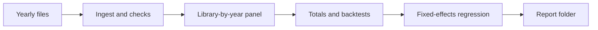

---

## 2. How shelf-to-screen is built

### 2.1 Components

| Component | Module | Purpose |
|---|---|---|
| Settings | `src/shelf_to_screen/config.py` | Environment variables and a local `.env` loader |
| Ingest | `src/shelf_to_screen/ingest.py` | Header map, number, flag and date parsers, branch and summary rows, file report |
| Panel | `src/shelf_to_screen/panel.py` | Library IDs with phone links, duplicates, checks, per-capita values, balanced flag |
| Totals | `src/shelf_to_screen/totals.py` | State totals, medians, jump flags, comparison with published totals |
| Forecast | `src/shelf_to_screen/forecast.py` | Naive, drift, linear and Holt models, rolling-origin backtest |
| Regression | `src/shelf_to_screen/regression.py` | Two-way fixed effects and pooled OLS with errors clustered by library |
| Classifier | `src/shelf_to_screen/classify.py` | High digital share, features with no target parts, GroupKFold by library |
| External | `src/shelf_to_screen/external.py` | Check of a book-sales proxy, yearly indicator with a coverage check |
| Synthetic data | `src/shelf_to_screen/synthetic.py` | Fake yearly files with the real format problems and known effects |
| Report | `src/shelf_to_screen/report.py` | Run all analyses and write the report folder |
| CLI | `src/shelf_to_screen/cli.py` | The `shelf-to-screen` command with 8 subcommands |

The component map shows which module calls which module. An arrow points from the caller to the module that it uses.

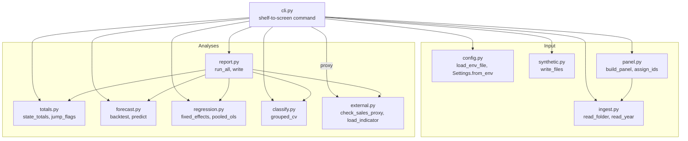

### 2.2 System context

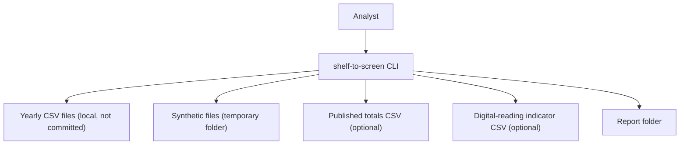

### 2.3 Repository layout

```
shelf-to-screen/
├── .github/workflows/ci.yml        # CI: Python 3.11, pip install -e ".[dev]", pytest -q
├── .env.example                    # 6 environment variables, all values empty
├── pyproject.toml                  # package, dev extra, shelf-to-screen script
├── data/README.md                  # source, terms, columns, format problems
├── docs/ste-style-guide.md         # writing rules and project vocabulary
├── src/shelf_to_screen/
│   ├── config.py  ingest.py        # settings, yearly file reader
│   ├── panel.py  totals.py         # library-by-year panel, state totals
│   ├── forecast.py  regression.py  # backtests, fixed effects
│   ├── classify.py  external.py    # grouped classifier, indicator checks
│   └── synthetic.py  report.py  cli.py
└── tests/                          # 37 tests, no network, no download
```

---

## 3. Design rules

### 3.1 Each header has one mapping
`map_headers` maps each raw header through `HEADER_MAP` after it removes decorative symbols and repeated spaces. An unknown header stops the ingest, so no rename can fail in silence.

### 3.2 Each number is parsed the same way
`parse_number` removes `$` and all commas, so `1,36,268` and `136,268` give 136268. A negative count becomes missing, and the file report counts it.

### 3.3 The clean step never changes a valid value
Names and cities keep their inner spaces. The code does not cap values. Checks add flags and counts, and the values stay as they are.

### 3.4 One row for each library and year
`assign_ids` makes a library ID from the normalised name and city. It links two IDs that share a 10-digit phone in one city. Branch rows and summary rows are dropped and counted.

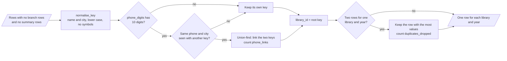

### 3.5 Totals come from the data
Each state total is a sum over the panel. The balanced panel holds the same libraries each year, so a change in it is not a change in who reports.

### 3.6 Forecasts see only the past
The backtest predicts each year from the earlier years only. No regressor carries information about a test year.

### 3.7 Associations, not causes
The regression removes library and year effects and clusters the errors by library. The report calls the result a within-library association.

### 3.8 Prototype problems and their fixes

| # | Problem in the earlier prototype | Fix in shelf-to-screen |
|---|---|---|
| 1 | The "Kindle sales" regressor was all zeros (book file ends in 2016, publisher text had two spaces) | `check_sales_proxy` finds both problems. A constant regressor raises `ConstantRegressor`. `load_indicator` needs each panel year |
| 2 | Forecasts used hand-typed totals and regressors tuned to the test years | Totals from the panel. Rolling-origin backtest against naive, drift, linear and Holt |
| 3 | 2020 and 2023 totals looked 10 times lower because of parse errors | One number parser, branch and summary rows removed, balanced-panel totals, jump flags |
| 4 | The classifier used parts of its target, label-encoded IDs and a random row split | `check_features` refuses circulation columns and IDs. GroupKFold by library. The limit comes from training libraries |
| 5 | Spaces were deleted in all text, all columns were capped, some renames failed | Inner spaces stay, no capping, unknown headers stop the ingest |
| 6 | No stable library ID, branch rows mixed with system rows | Library IDs with phone links, branch rows dropped, duplicates resolved |
| 7 | Causal claims from one-year OLS | Two-way fixed effects with clustered errors and descriptive wording |
| 8 | Colab paths, inline installs, cell-order effects | One CLI, settings from environment variables, tests |

---

## 4. The end-to-end workflow

### 4.1 Full flow

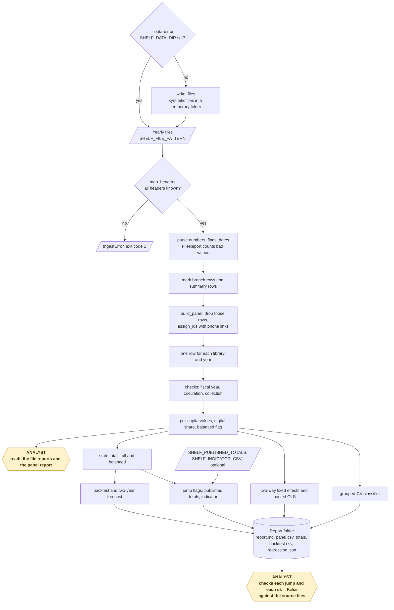

### 4.2 The life cycle of one yearly file

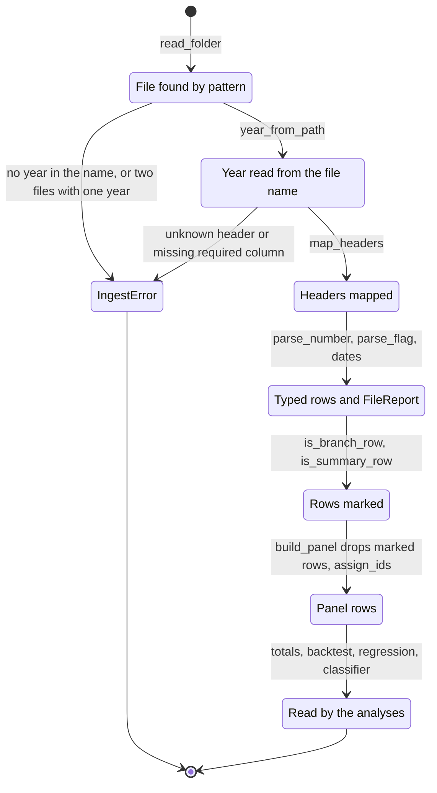

1. `read_folder` finds the file with `SHELF_FILE_PATTERN` and reads the year from the file name.
2. `map_headers` maps each header or stops with `IngestError`.
3. The parsers change each number, flag and date, and the file report counts the bad values.
4. The ingest marks branch rows and summary rows.
5. `build_panel` drops those rows, gives each row a library ID and keeps one row for each library and year.
6. The checks add flags, and the panel adds per-capita values.
7. The totals, the backtests, the regression and the classifier read the panel.

### 4.3 Who does which step

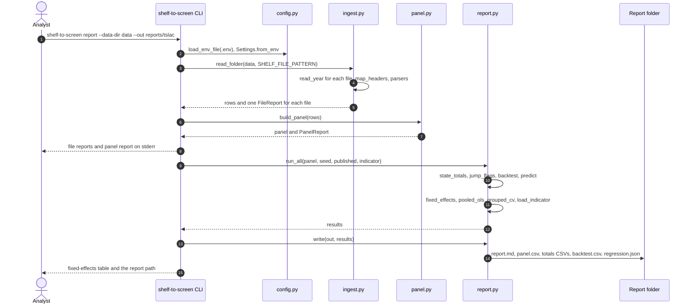

---

## 5. The ingest and the panel

**Purpose.** Change the raw yearly files into a validated library-by-year panel.

The ingest (`ingest.read_year`) reads one yearly file:

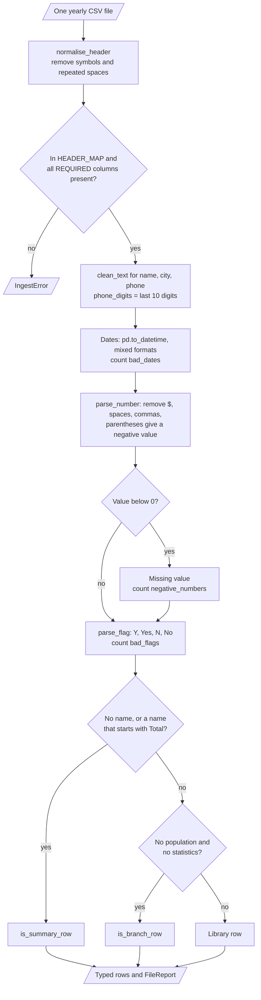

| Input | Output |
|---|---|
| Yearly CSV files | The panel and one `FileReport` for each file, plus a `PanelReport` |

**Procedure**

1. Map each header. Stop on an unknown header or a missing required column.
2. Parse each number: remove `$`, spaces and commas. Parentheses give a negative value.
3. Set a negative value to missing and count it.
4. Parse `Y`/`Yes`/`N`/`No` flags. Count other values (for example `15256`).
5. Parse the fiscal-year dates in any common format.
6. Mark a row with no name, or a name that starts with `Total`, as a summary row.
7. Mark a row with no population and no statistics (service hours do not count) as a branch row.
8. Drop the branch rows and the summary rows.
9. Make the library ID from the normalised name and city. Link IDs that share a phone in one city.
10. If a library has two rows in one year, keep the row with the most values.
11. Add per-capita values, the digital share and the balanced flag.

The panel step (`panel.build_panel`) does steps 8 to 11:

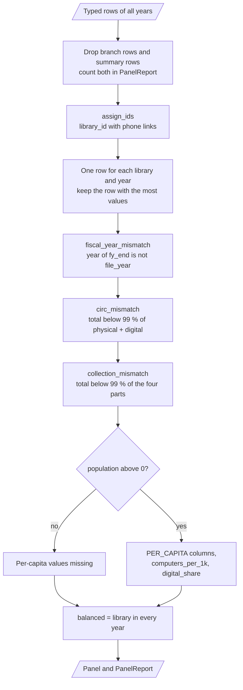

| Per-capita value | Formula |
|---|---|
| `circ_pc`, `circ_physical_pc`, `circ_digital_pc`, `visits_pc`, `ebooks_pc`, `eaudio_pc`, `print_books_pc` | Column / population |
| `staff_exp_pc`, `print_exp_pc`, `elec_exp_pc`, `website_visits_pc` | Column / population |
| `computers_per_1k` | 1000 × computers / population |
| `digital_share` | `circ_digital` / (`circ_physical` + `circ_digital`) |

**Rules**

- The population must be above 0 for a per-capita value.
- The physical and digital circulation columns cover "all other ages". The total also covers children, so the total can be larger than the two parts.

---

## 6. State totals and forecasts

**Purpose.** Show the yearly change, and test whether a forecast is better than simple baselines.

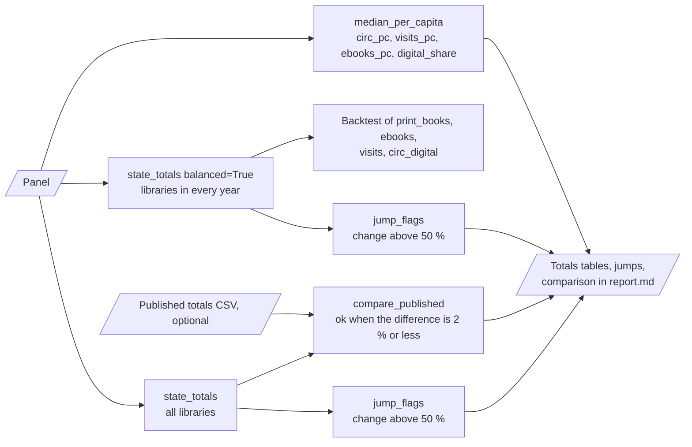

| Table | Contents |
|---|---|
| State totals, all libraries | Sum of each metric, libraries and libraries with circulation, for each year |
| State totals, balanced panel | The same, only for libraries in every year |
| Median per-capita values | Medians of `circ_pc`, `visits_pc`, `ebooks_pc`, `digital_share` |
| Jump flags | Changes of more than 50 % from one year to the next |

| Forecast model | Rule |
|---|---|
| `naive` | Next year = last year |
| `drift` | Last year + mean yearly change |
| `linear` | Least-squares line through the years |
| `holt` | Holt linear trend. Alpha and beta from a grid of in-sample one-step errors |

**Procedure (backtest)**

1. Take the balanced-panel total of a metric.
2. For each origin from the 4th year, fit each model on the earlier years.
3. Forecast the next year and record the absolute error and the percentage error.
4. Rank the models by mean absolute error. Forecast two years with the best model.

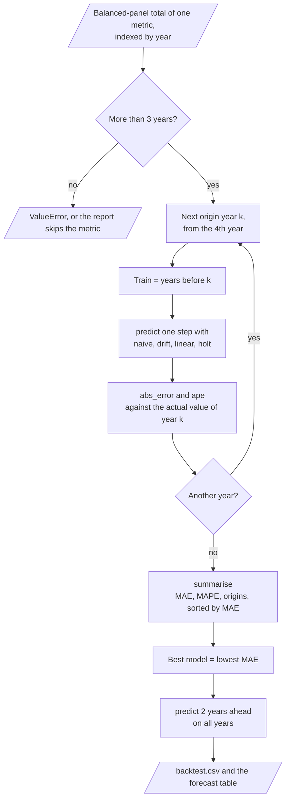

**Rules**

- The backtest needs more than 3 years. With 6 years, each model has 3 errors.
- The report shows each error, so a reader can see how few points the ranking uses.

---

## 7. The regression, the classifier and external indicators

**Two-way fixed effects.** The outcome is `log_visits_pc`. The default regressors are `ebooks_pc` and `elec_exp_pc`.

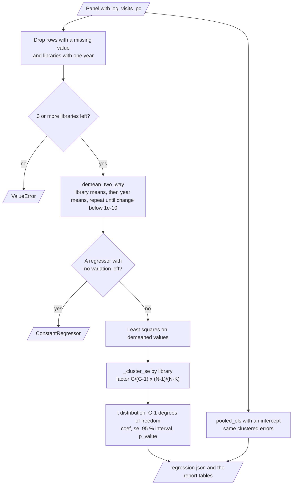

1. Drop the rows with a missing value and the libraries with one year.
2. Remove the library means and the year means by alternating projections until the change is below 1e-10.
3. Stop with `ConstantRegressor` if a regressor has no variation left.
4. Fit least squares on the demeaned values.
5. Calculate errors clustered by library, with the factor G/(G−1) × (N−1)/(N−K). Use a t distribution with G−1 degrees of freedom.
6. Fit pooled OLS with the same regressors for comparison.

**Classifier.** The target is a digital share above the median of the training libraries in each fold.

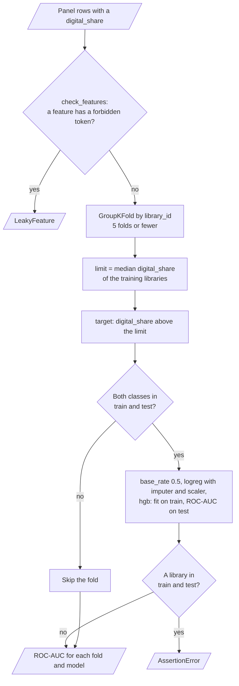

| Rule | Value |
|---|---|
| Features | `population`, per-capita spending and holdings, `visits_pc`, `computers_per_1k`, `website_visits_pc`, `service_hours`, `file_year` |
| Forbidden tokens | `circ`, `digital_share`, `name`, `phone`, `city`, `library_id` |
| Split | GroupKFold by library, 5 folds |
| Models | Base rate (AUC 0.5), logistic regression, gradient boosting |

**External indicators.** `check_sales_proxy` reports the exact and the space-insensitive publisher matches, the latest publishing year and the covered panel years. It stops with `ProxyError` when no panel year is covered. `load_indicator` needs a value for each panel year and a value that changes. With about six yearly points, the report shows correlations as a description only.

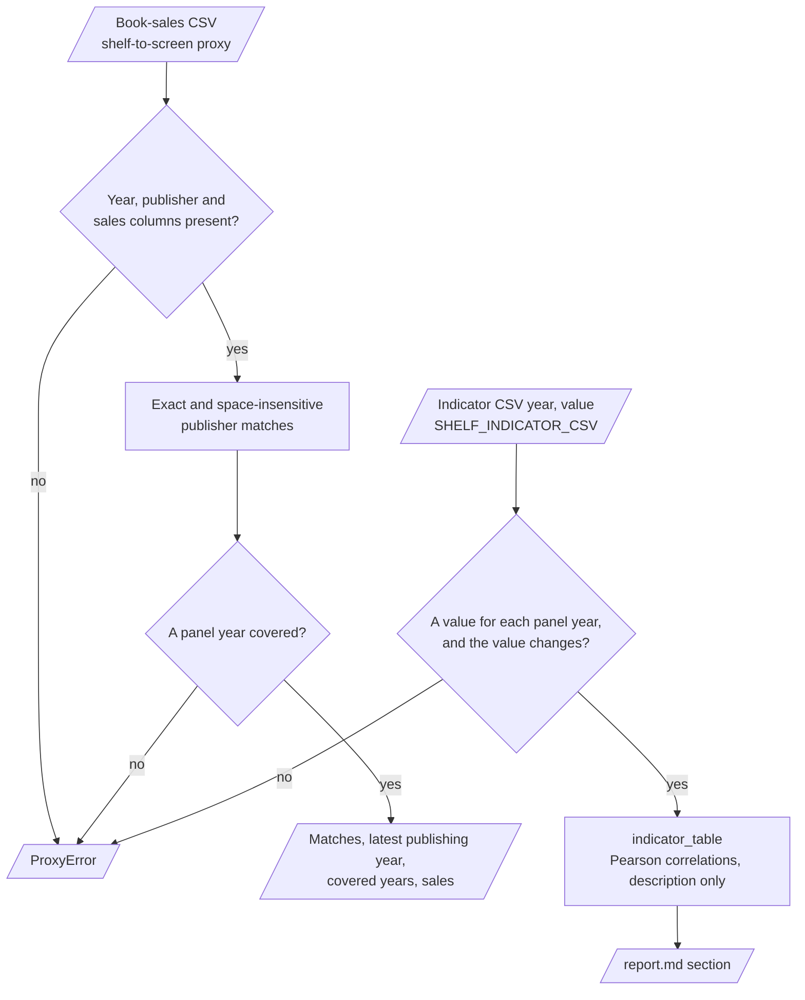

---

## 8. The checks and the decision rules

Each check leads to one of five actions. The diagram groups the checks by action, in the sequence that the code applies them: `read_year`, then `build_panel`, then `run_all`.

```mermaid
flowchart LR
    subgraph STOPG["Stop: IngestError, exit code 1"]
        S1["Unknown header"]
        S2["Missing required column"]
    end
    subgraph MISSG["Missing value, counted in FileReport"]
        M1["Bad number, bad flag, bad date"]
        M2["Negative number"]
    end
    subgraph DROPG["Dropped, counted in PanelReport"]
        D1["Branch row"]
        D2["Summary row"]
        D3["Duplicate: keep the row with the most values"]
    end
    subgraph FLAGG["Flag column, counted in PanelReport"]
        F1["fiscal_year_mismatch"]
        F2["circ_mismatch, below 99 %"]
        F3["collection_mismatch, below 99 %"]
    end
    subgraph LISTG["Listed in report.md"]
        L1["Jump above 50 %"]
        L2["Published total differs by more than 2 %: ok = False"]
    end
    STOPG --> MISSG --> DROPG --> FLAGG --> LISTG
```

| Check | Rule | Action |
|---|---|---|
| Unknown header | Not in `HEADER_MAP` | Stop |
| Bad number, bad flag, bad date | Text that does not parse | Missing value, counted |
| Negative number | Below 0 | Missing value, counted |
| Branch row | No population and no statistics | Dropped, counted |
| Summary row | No name, or a name that starts with `Total` | Dropped, counted |
| Duplicate | Two rows for one library and year | Keep the row with the most values |
| Fiscal-year mismatch | Year of `fy_end` is not the reporting year | Flag, counted |
| Circulation mismatch | Total below 99 % of physical + digital | Flag, counted |
| Collection mismatch | Total below 99 % of print + audio + e-books + e-audio | Flag, counted |
| Jump | Year-over-year change above 50 % | Listed in the report |
| Published totals | Relative difference above 2 % | `ok = False` in the report |

---

## 9. Data and file map

| Path | Committed? | Contents |
|---|---|---|
| `data/README.md` | Yes | Source, terms, columns and format problems |
| `data/*.csv`, `data/synthetic/` | No (git ignores it) | Yearly files, synthetic files, panel exports |
| `reports/<name>/report.md` | No (git ignores it) | Full report |
| `reports/<name>/panel.csv` | No (git ignores it) | The panel |
| `reports/<name>/totals_all.csv`, `totals_balanced.csv` | No (git ignores it) | State totals |
| `reports/<name>/backtest.csv`, `regression.json` | No (git ignores it) | Backtest errors, regression tables |
| `.env.example` | Yes | All 6 environment variables, empty |
| `.env` | No (git ignores it) | Local settings |

---

## 10. How to run shelf-to-screen

### 10.1 Prerequisites

| Need | For |
|---|---|
| Python 3.11+ | All components |
| numpy, pandas, scipy, scikit-learn | Core (installed with the package) |
| The TSLAC yearly files | Results on real libraries (optional) |

### 10.2 Installation

```bash
git clone https://github.com/KrishnaAnnavaram/shelf-to-screen.git
cd shelf-to-screen
python -m venv .venv
. .venv/bin/activate            # Windows: .venv\Scripts\activate
pip install -e ".[dev]"
```

### 10.3 Run shelf-to-screen

Offline (synthetic files):

```bash
shelf-to-screen report                               # 150 synthetic libraries -> reports/latest
shelf-to-screen synth --libraries 150 --out-dir data/synthetic
shelf-to-screen ingest --data-dir data/synthetic --out data/panel.csv
shelf-to-screen totals --data-dir data/synthetic
shelf-to-screen backtest --data-dir data/synthetic --metric ebooks
shelf-to-screen regress --data-dir data/synthetic --regressors ebooks_pc,elec_exp_pc
shelf-to-screen classify --data-dir data/synthetic
```

With the real files:

```bash
shelf-to-screen ingest --data-dir data                         # read the file reports first
shelf-to-screen report --data-dir data --out reports/tslac
shelf-to-screen proxy data/Books_Data_Clean.csv                # check a book-sales file as a proxy
```

`python -m shelf_to_screen` is the same as `shelf-to-screen`. An error prints `error: <message>`, and the exit code is 1.

Each data command finds its input in this sequence:

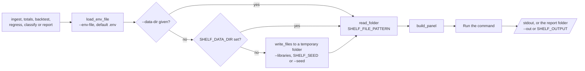

### 10.4 Environment variables

| Variable | Used by | Meaning |
|---|---|---|
| `SHELF_DATA_DIR` | Data commands | Folder with the yearly files. Empty: synthetic files |
| `SHELF_FILE_PATTERN` | Ingest | File pattern. Default `*LibraryDataset.csv` |
| `SHELF_OUTPUT` | `report` | Report folder. Default `reports/latest` |
| `SHELF_SEED` | Data commands | Seed of the synthetic files and the classifier. Default 42. The `synth` command does not read it: it uses `--seed`, default 0 |
| `SHELF_PUBLISHED_TOTALS` | `report` | CSV `year, metric, value` to check the totals |
| `SHELF_INDICATOR_CSV` | `report` | CSV `year, value` of a digital-reading indicator |

The CLI reads `--env-file` (default `.env`) first. A variable that is already set is not replaced.
The project needs no credentials.

---

## 11. How to extend shelf-to-screen

| You want to… | Do this | Code change? |
|---|---|---|
| Add a year | Put the new file in the data folder | No |
| Check against published totals | Write `year, metric, value` and set `SHELF_PUBLISHED_TOTALS` | No |
| Add a digital-reading indicator | Write `year, value` for each panel year and set `SHELF_INDICATOR_CSV` | No |
| Add a renamed column | Add the header to `HEADER_MAP` | Small |
| Use other regressors | `regress --regressors a,b` | No |
| Use a stable state ID | Add the ID column to `HEADER_MAP` and use it in `assign_ids` | Small |

Planned milestones (not built): a stable ID from the state or federal library survey, regional maps and an event-study view of 2020.

---

## 12. Validation results

| Validation | Result | Command |
|---|---|---|
| Unit tests (CI installs only `.[dev]`) | **37 passed** | `pytest -q` |
| Synthetic panel (150 libraries, seed 42) | 862 rows, 121 balanced libraries, 85 branch rows dropped, 1 phone link | `shelf-to-screen report` |
| Synthetic fixed effects | `ebooks_pc` 0.764 [0.709, 0.818]. True value 0.8. Pooled OLS 1.849 (biased) | `shelf-to-screen report` |
| Synthetic classifier (5 grouped folds) | ROC-AUC: logistic 0.862, gradient boosting 0.978, base rate 0.5 | `shelf-to-screen report` |
| Real files, ingest (local run, not in CI) | 3,159 rows, 557 libraries, 488 balanced, 687 branch rows and 1 state total row dropped, 7 phone links | `shelf-to-screen report --data-dir ...` |
| Real files, balanced visits (local run) | 64.5 M (2018), 34.2 M (2020), 22.6 M (2021), 42.7 M (2023) | `shelf-to-screen report --data-dir ...` |
| Real files, balanced e-books (local run) | 13.8 M (2018) to 34.6 M (2023) | `shelf-to-screen report --data-dir ...` |
| Real files, fixed effects (local run) | `ebooks_pc` 0.000 [−0.001, 0.001], `elec_exp_pc` 0.020 [−0.003, 0.042] | `shelf-to-screen report --data-dir ...` |
| Real files, backtest (local run) | Lowest MAE: naive for print and visits, drift for e-books, linear for digital circulation | `shelf-to-screen report --data-dir ...` |

The synthetic results show that the fixed-effects step removes a known library bias. The pooled estimate is more than twice the true value.
The real-file runs used local copies of the public TSLAC files. CI does not download them, so CI does not reproduce these numbers.
With correct parsing, the 2020 and 2023 state totals are not 10 times lower, which the earlier prototype showed (prototype result, not reproduced here). The real visit drop in 2020 and 2021 stays.
Inside a library, e-book holdings per capita have no measurable association with visits per capita in these six years.

---

## 13. Known problems

Read these problems before you use shelf-to-screen for a publication.

| # | Area | Problem | Impact and action |
|---|---|---|---|
| 1 | Library IDs | The files have no stable ID. Name, city and phone links can miss a renamed library or join two libraries | Read the phone links and the duplicates in the panel report. Add a state ID when you have one |
| 2 | Fiscal years | Libraries have different fiscal years. The panel uses the reporting year | Compare libraries with the same fiscal year if timing matters |
| 3 | Forecasts | Six yearly points give 3 backtest errors for each model | Use the forecasts as a description, not as a plan |
| 4 | Regression | The fixed-effects result is an association. Holdings and visits can both follow a third cause | Do not read it as a causal effect |
| 5 | Indicator | A yearly state-level indicator is collinear with the year effects | The report shows its correlations only |
| 6 | Real data in CI | CI tests synthetic files only | Run `report --data-dir` on the real files and read the file reports |
| 7 | Jumps | E-books grew 56 % in 2022 and e-audio 167 % in 2023 in the balanced panel | Check whether a reporting rule changed before you use these changes |
| 8 | Classifier | On synthetic data the reporting year drives the digital share, so the scores are high | The classifier describes, it does not predict a new library type |

---

## 14. Key points

1. **Each number is parsed the same way.** Both digit groupings give the same value, and bad values are counted, not guessed.
2. **One row for each library and year.** Branch rows and the state total row are removed, and renamed libraries are linked by phone.
3. **Totals come from the data.** The balanced panel separates real change from changes in who reports.
4. **Forecasts see only the past.** Each model is compared with naive and drift baselines in a rolling-origin backtest.
5. **Associations are within libraries.** Two-way fixed effects and clustered errors replace one-year OLS.
6. **The full demo runs offline.** All 37 tests run without a download, a key or a network.

---

## 15. Glossary

| Term | Meaning |
|---|---|
| **Backtest** | One-step-ahead forecasts from each origin year, with errors |
| **Balanced panel** | The libraries that report in every year |
| **Branch row** | A row with a name and no statistics except service hours |
| **Clustered errors** | Standard errors that allow correlation inside each library |
| **Digital share** | Digital circulation divided by physical plus digital circulation |
| **Fiscal year** | The local fiscal year of a library |
| **Fixed effects** | Library and year means removed before the regression |
| **Header map** | The mapping from raw headers to short column names |
| **Indicator** | A yearly external digital-reading series |
| **Library ID** | The normalised name and city, linked by phone |
| **Panel** | One row for each library and reporting year |
| **Per-capita value** | A value divided by the legal service area population |
| **Pooled OLS** | A regression with no fixed effects |
| **Reporting year** | The year in the name of a yearly file |
| **State total** | The sum of a column over the libraries of one year |
| **Summary row** | A row with no name, for example a state total |
| **Yearly file** | One statistics export for one reporting year |

---

## 16. License

[MIT](LICENSE) © 2026 Krishna Annavaram
